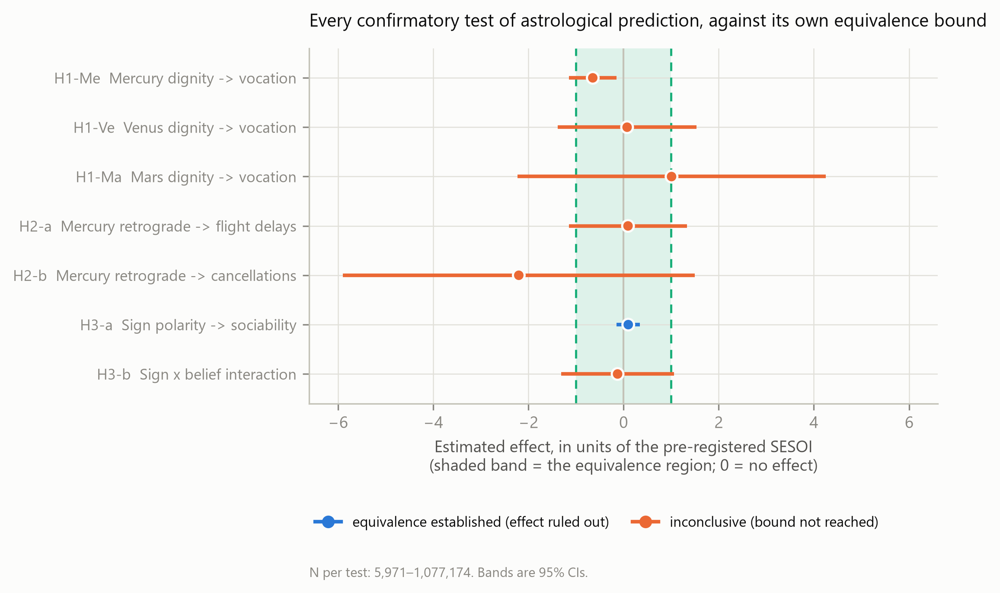
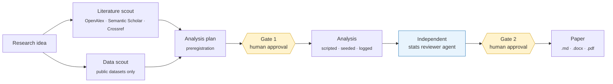

<div align="center">

# AI Papermill

**Rigorous answers to odd research questions, from open data, for almost nothing.**

An agent pipeline built on Claude Code. It takes a research question and returns a preregistered, statistically reviewed, fully reproducible paper, and it publishes its own mistakes.

[](requirements.txt)
[](https://docs.claude.com/en/docs/claude-code)
[](LICENSE)
[](#honesty-and-known-errors)
[](ERRATA.md)

[Example paper](projects/astrology-efficacy/paper/manuscript.pdf) · [How it works](#how-it-works) · [Guardrails](#rigour-and-guardrails) · [Errata board](ERRATA.md) · [Quickstart](#quickstart)

</div>

---

## Why this exists

**Research is expensive, so many questions never get a proper test.** A funded study costs months of salary, and the grant has to be justified first. So the odd questions ("does Mercury retrograde actually delay flights?", "do pesticide-heavy regions have higher cancer mortality?") are often answered by anecdote or not at all, even when public data could settle them.

**An AI has different incentives from a researcher who needs publications.** It doesn't need a positive result, a career, or a story that gets past reviewers. That makes it possible to enforce the practices science already knows it should follow, but often doesn't: fix the analysis plan before looking at the outcome, report every preregistered test, lead with the failures, and state what a null result *rules out* rather than just calling it "not significant".

**This is not a replacement for real research.** Open data is limited, the designs are observational, and no human peer reviewer has signed off. The goal is a decent answer where a funded study is out of reach, and a clear sign of whether a question deserves one.

---

## Example run: *does astrology predict anything?*

One research idea became three preregistered studies on three public datasets, with seven confirmatory tests.

| | Question | Open data | Design | Headline |
|---|---|---|---|---|
| **1** | Does a planet's zodiac sign at birth predict occupation, as Ptolemy claims? | 3.7 M Wikidata biographies, JPL ephemeris | Regression discontinuity at sign boundaries | Mercury effect bounded at **OR ≤ 1.012**. ⚠️ Primary design failed 3 validity checks; the claims rest on a pre-specified backup estimator |
| **2** | Does Mercury retrograde disrupt air travel? | 159 M US flights (BTS), 2000–2024 | Interrupted time series, circular block permutation | +0.048 pp delay share, **p = .890**. Effect bounded at 0.57 pp |
| **3** | Are "positive" sun signs more sociable? | 39,125 General Social Survey respondents | Survey regression with TOST and Bayes factors | *d* = 0.010, **equivalence established**, BF₀₁ = 5.38 |

<p align="center">
  
  <br>
  <sub><b>Every confirmatory test, drawn against its own preregistered equivalence bound.</b> Blue means the effect is ruled out; orange means the bound was not reached. Caveat: the three Study 1 rows show the preregistered <i>primary</i> estimator, which the paper later declares invalidated (the Mercury row is the negative, wrong-direction estimate). The headline OR ≤ 1.012 comes from the backup estimator in Table 2 of the paper (see <a href="ERRATA.md">A-16</a>).</sub>
</p>

The positive controls worked: the same pipeline recovered the known relative-age effect and a genuine birth-seasonality cycle, so the nulls are not the output of a broken analysis.

📄 [Read the paper (PDF)](projects/astrology-efficacy/paper/manuscript.pdf) · 📋 [Preregistration](projects/astrology-efficacy/analysis/plan.md) · 🔍 [Independent stats review](projects/astrology-efficacy/review/stats_review.md)

---

## How it works



1. **Scout.** Two subagents run in parallel. One searches the literature through keyless scholarly APIs, and every citation must come from an API response. The other finds public datasets that actually contain the needed variables and records their licences and provenance.
2. **Plan.** Hypotheses, models, smallest effect size of interest, inference rules and falsification checks are written down *before* any outcome data is touched. **The pipeline stops here until a human approves.**
3. **Analyse.** Numbered Python scripts with fixed seeds. A single `run_all.py` regenerates every number, figure and table, and nothing in the results is typed by hand.
4. **Review.** A separate reviewer agent audits the work for plan adherence, statistical validity and reproducibility, and issues a verdict with must-fix items. **The pipeline stops again.**
5. **Write.** An APA-style manuscript in which every number traces back to a JSON file produced by code.

The whole pipeline is plain Markdown: a [`CLAUDE.md`](CLAUDE.md) with the rules, plus [agents](.claude/agents/) and [skills](.claude/skills/) for each phase.

---

## Rigour and guardrails

These guardrails are what make the output worth reading.

| Guardrail | How it's enforced |
|---|---|
| **Plan before peeking** | Hypotheses and decision rules are frozen at Gate 1. Later changes go in a dated Deviations table, never back into the plan. |
| **Verbatim hypotheses** | The paper quotes its hypotheses word for word from the preregistration, so readers can check for drift. |
| **No fabrication** | Citations come only from API responses. The astrology study re-resolved all 37 references against Crossref/DataCite/OpenAlex (37/37 verified). |
| **Every number from code** | Results files are generated from JSON written by the analysis scripts. |
| **Equivalence, not "n.s."** | Every null result is reported with a TOST equivalence test and a Bayes factor against a preregistered smallest effect of interest, so a null says what it rules out. |
| **Falsification battery** | Positive controls, placebo cutoffs, density and balance tests, all specified in advance, with invalidation rules the pipeline has to honour. |
| **Independent review** | A separate agent with its own instructions audits the analysis before any writing starts. |
| **Associational language** | Observational results are described as "associated with", never as causes, unless the design earns it. |
| **Failures go first** | When Study 1's primary design failed three validity checks, the paper said so in the abstract and declared the design invalidated under its own preregistered rules. |

---

## Honesty and known errors

> [!IMPORTANT]
> **I have not verified every claim in these papers.** The guardrails reduce errors; they do not remove them. Both reviewer agents disclosed that they could not execute code, so reproducibility was checked by reading, not by re-running.

That is why this repo has an **[errata board](ERRATA.md)**. It lists every known problem: what the reviewer agent caught before publication (15 items so far, from overclaimed conclusions to silently swapped methods) and what is still open (8). It also records the recurring patterns of AI failure, which may turn out to be the most useful thing this project produces.

**Found a mistake? That's a contribution.** [Open an erratum](../../issues/new?template=erratum.yml) and it will be logged with credit. Method debates are welcome in Discussions; see [CONTRIBUTING.md](CONTRIBUTING.md).

---

## Results so far

| Study | Question | Data | Outcome | Review | Cost | Runtime |
|---|---|---|---|---|---|---|
| Astrology · 1 | Planetary sign → occupation | Wikidata, 3.7 M people | 🟡 **Partly conclusive.** Mercury effect ruled out (OR ≤ 1.012); Venus and Mars inconclusive; primary design invalidated | pass with fixes | n/t† | n/t† |
| Astrology · 2 | Mercury retrograde → flight disruption | BTS, 159 M flights | 🟠 **Null, not quite equivalent.** Bounded at 0.57 pp vs a 0.5 pp SESOI | pass with fixes | n/t† | n/t† |
| Astrology · 3 | Sun sign → sociability | GSS, 39 k respondents | 🟢 **Equivalence established** (*d* ≤ 0.030). Belief-interaction test inconclusive | pass with fixes | n/t† | n/t† |
| [Pesticides → breast cancer](projects/pesticide-breast-cancer-france/paper/manuscript.pdf) | Pesticide sales intensity → female breast cancer mortality, French departments | BNV-D, Santé publique France, INSEE; 91 departments | ⚪ **Inconclusive, underpowered.** β = 0.158, 95% CI [−0.126, 0.443], p = .275; minimum detectable partial r ≈ .29 | pass with fixes | n/t† | n/t† |

<sub>† <b>Not tracked.</b> Cost and runtime weren't logged for these runs, and reconstructing them from memory would go against the project's own rules. Tracking starts with the next run. Data costs were zero in every case.</sub>

---

## Limitations

- **Observational data only.** Most answers are associations, not causes. The pesticide study is ecological, so department-level patterns say nothing about individuals.
- **Bounded by what open data exists.** When the right variable isn't public, the pipeline must say so and propose alternatives, which limits which questions it can answer.
- **No human peer review.** The gates put a human in the loop for approval, not for line-by-line verification.
- **The reviewer is an AI too.** It comes from the same model family as the analyst, so shared blind spots are likely. In both runs it also couldn't execute code (see [ERRATA](ERRATA.md) A-14 and P-07).
- **Small samples stay small.** The pesticide study had N = 91 and could only detect partial r ≥ .29. The pipeline reports that honestly, but it can't fix it.
- **Reproducibility has gaps.** For example, one astrology stage is missing from `run_all.py` (A-13). The errata board tracks these.
- **Costs are unmeasured so far,** so the "almost nothing" claim rests on zero data fees plus LLM usage, not on logged numbers yet.
- **Developed and tested on Windows only.**

---

## Quickstart

**Requirements:** [Claude Code](https://docs.claude.com/en/docs/claude-code) (a Claude subscription or an Anthropic API key) and Python 3.12. Optional: [pandoc](https://pandoc.org/) and a LaTeX distribution for .docx/.pdf output. No data-provider API keys are needed.

```bash
git clone https://github.com/AndreasADL/ai-papermill.git
cd ai-papermill
pip install -r requirements.txt

# optional: identifies you to OpenAlex/Crossref/Wikidata so they can reach you if your client misbehaves
export PAPERMILL_CONTACT_EMAIL="you@example.org"     # PowerShell: $env:PAPERMILL_CONTACT_EMAIL="you@example.org"

claude
```

Then describe your study in plain language:

> *Correlational study: is national income inequality associated with life satisfaction across countries, controlling for GDP per capita?*

The agent scouts literature and data, then **stops at Gate 1** with a plan for you to approve. After approval it runs the analysis, has the reviewer audit it, **stops at Gate 2** with results and verdict, and then writes the paper into `projects/<slug>/`.

**Reproduce an existing study:**

```bash
pip install -r projects/pesticide-breast-cancer-france/requirements.txt
python projects/pesticide-breast-cancer-france/analysis/run_all.py
```

Raw data isn't committed. Each study's `data/README.md` explains how it is re-downloaded.

---

## Repository layout

```
.
├── CLAUDE.md              the rules every run follows
├── .claude/
│   ├── agents/            lit-scout · data-scout · stats-reviewer
│   └── skills/            literature-scan · data-scout · analysis-plan · run-analysis · stats-review · write-paper
├── projects/              one self-contained folder per study (see projects/README.md)
├── ERRATA.md              known errors, open and fixed
└── CONTRIBUTING.md
```

---

<div align="center">
<sub>
Code: <a href="LICENSE">MIT</a> · Generated manuscripts and figures: CC BY 4.0 · Third-party data keeps its original licence (see each study's <code>data/provenance.md</code>)
<br>
All papers in this repository are AI-generated, not peer-reviewed, and should not be cited as scholarly sources.
</sub>
</div>
