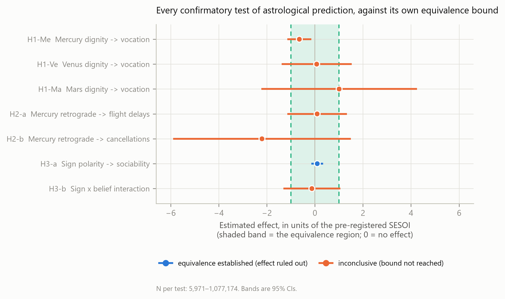
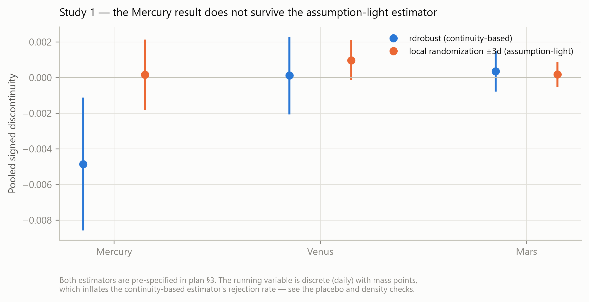
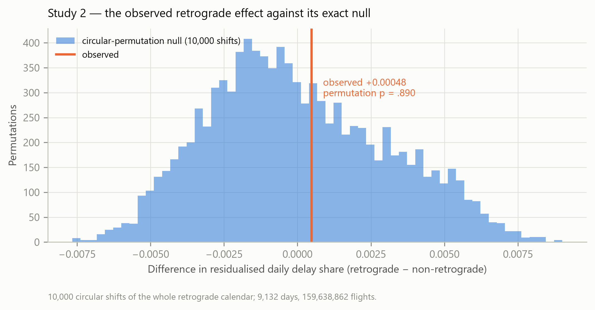
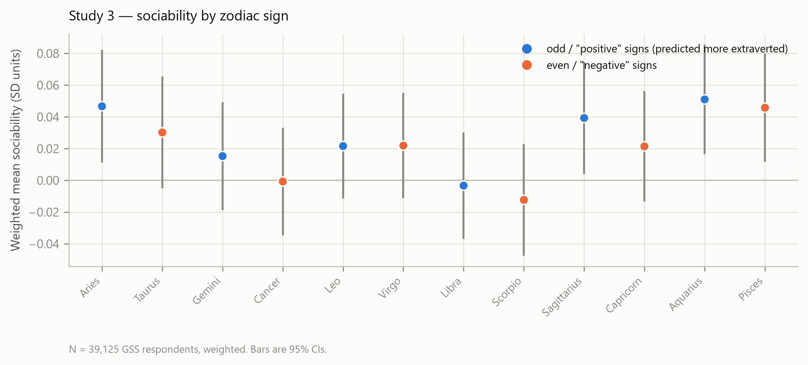
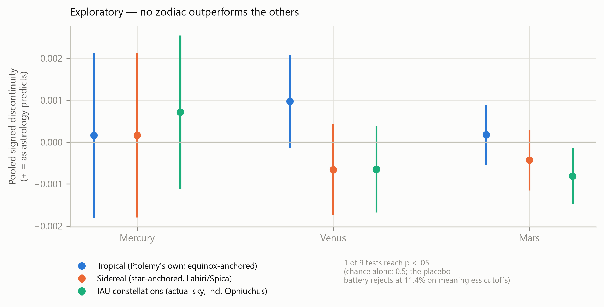

> **AI-generated manuscript.** Produced autonomously by AI Papermill, an LLM agent pipeline. It is **not peer-reviewed** and **not fully human-verified**, so do not cite it as a scholarly source. Every number traces to executed code and all 37 references were re-verified against Crossref/DataCite/OpenAlex, but errors are expected. Known issues are listed in the project's [ERRATA.md](../../../ERRATA.md).

---

# Introduction

Astrology makes falsifiable claims. It asserts that the positions of solar-system bodies at the moment of birth predict stable individual characteristics, and that dated planetary configurations predict elevated rates of specific real-world events. Both assertions are, in principle, testable against public data at scale.

The empirical literature has tested them repeatedly and found nothing. @Carlson1985 had astrologers match natal charts to California Psychological Inventory profiles under double-blind conditions; match rates did not exceed chance, and the astrologers' own pre-registered success criterion was not met. @WymanVyse2008 replicated that logic with NEO-FFI profiles and computer-generated chart interpretations, with the same outcome. @HartmannReuterNyborg2006 tested date-of-birth-derived astrological variables against Big Five personality and general intelligence at large scale and reported null associations. @HelgertzScott2020 used full-population Swedish register data (1968–2001) to ask whether astrologically compatible sun-sign couples marry more or divorce less, and found no consistent evidence.

The most demanding prior design is @DeanKelly2003, which is also the closest existing analogue to the strategy we adopt. They examined "time twins" — people born only minutes apart, and therefore holding nearly identical natal charts — and found no hint of the similarities astrology predicts. Their accompanying meta-analysis of more than forty controlled studies found that astrologers performed no better than chance even on comparatively basic tasks, specifically including the prediction of extraversion, which is the exact claim our Study 3 tests. Notably, astrologers who attributed their readings to psychic ability performed no better than those who did not.

These results are consistent, but they share a limitation that undercuts their evidential value: **each reports a bare non-significant result rather than an effect size it excludes**. This holds even for @DeanKelly2003, whose meta-analytic synthesis concludes that astrological influences, if any exist, "would seem to be very weak or very rare" — a qualitative statement rather than a quantified bound. None of these studies computes an equivalence bound or a Bayes factor. As @LakensScheelIsager2018 and @Lakens2017 set out, failing to reject a null hypothesis licenses no inference about the absence of an effect; the appropriate tool is a test against a smallest effect size of interest (SESOI). @Dienes2014 and @KeysersGazzolaWagenmakers2020 make the parallel Bayesian argument, and both stress that an inconclusive Bayes factor must be reported as data insensitivity rather than as support for the null. The existing skeptical literature on astrology therefore rests on a logical form its own methodologists would reject.

A second problem afflicts the naive design. Asking whether sun signs differ on some outcome is uninformative in both directions. It is confounded when positive, because season of birth genuinely predicts real outcomes: @DaviesEtAl2003 report a pooled OR of 1.07 (95% CI 1.05–1.08) for winter/spring birth and schizophrenia across 126,196 cases, with a Southern-Hemisphere companion pattern in @McGrathWelham1999 and Danish register confirmation in @MortensenEtAl1999; @DayEtAl2015 find summer-born UK Biobank adults taller by roughly 6.5 mm alongside associations with birth weight, pubertal timing and educational attainment; @GavrilovGavrilova2011 report birth-month associations with survival to age 100. Relative-age effects are similarly robust, in sport [@BjorndalEtAl2018; @SmithEtAl2018] and in education around school-entry cutoffs [@McEwanShapiro2008; @CornelissenDustmann2019]. A raw sun-sign difference is evidence of seasonality, for which astrology would take undeserved credit.

The naive design is also contaminated by self-attribution. @vanRooij1999 found sign-congruent self-description **only** among respondents with astrological knowledge, and @ChicoLorenzoSeva2006 document systematic correlates of astrological belief. Survey designs that test a main effect conflate "astrology is true" with "believers conform to their sign." Recent work confirms that belief itself has strong predictors — intelligence [@EdwardsEtAl2025] and narcissism [@AnderssonPerssonKajonius2021] — without bearing on sign-trait accuracy.

Critically, the documented season-of-birth confounds are **smooth in birth date**. They operate through gestational conditions, photoperiod and cohort timing, none of which changes discontinuously. This suggests the identification strategy we adopt: compare individuals born a few days apart across a sign boundary. Such individuals share season, photoperiod, maternal conditions and school cohort, but are assigned opposite characters by astrology. A smooth confound predicts a smooth outcome function through the cusp; only a genuine sign effect predicts a jump. The regression discontinuity apparatus for this is mature [@ImbensLemieux2007; @CalonicoCattaneoTitiunik2014Econometrica; @CalonicoCattaneoTitiunik2014Stata], including the multi-cutoff case [@CattaneoKeeleTitiunikVazquezBare2016], manipulation testing [@McCrary2008; @CattaneoJanssonMa2018], and — decisively for our application — the treatment of discrete running variables [@CattaneoIdroboTitiunik2023].

For event claims, Mercury retrograde offers an unusually clean treatment: deterministic, publicly pre-announced, computable to the second, and caused by nothing human, which makes reverse causation and selection impossible. The existing tests are sparse and weak. @QiWangZhang2022 is an unreviewed preprint; @KonakOzkahveci2022 model retrograde windows against BRICS and Turkish equity indices with EGARCH and report mixed, mostly non-significant results. Neither uses an exact-null approach, although the adjacent lunar-phase finance literature provides design templates [@YuanZhengZhu2006; @KeefKhaled2010]. We found no peer-reviewed test of Mercury retrograde against transport, IT or accident outcomes at all.

## The present research

We test three classes of astrological claim, each with an identification strategy built to defeat one of the problems above, and we frame every result as an equivalence bound rather than a bare null. The hypotheses below are reproduced verbatim from the pre-registered analysis plan.

**Study 1 — essential dignity and vocation.** Doctrine: *essential dignity* — a planet in its own domicile expresses its significations strongly; in the opposite sign (detriment) weakly. Rulerships are canonical (*Tetrabiblos* I.17). Occupational significations are taken verbatim from *Tetrabiblos* IV.4.

> **H1-Me.** Mercury. Domicile Gemini, Virgo; detriment Sagittarius, Pisces. Outcome class: writer, journalist, translator, teacher, businessperson, banker, accountant. Predicted direction: share **higher** in domicile.
>
> **H1-Ve.** Venus. Domicile Taurus, Libra; detriment Scorpio, Aries. Outcome class: painter, dyer, textile/clothing, innkeeper, perfumer. Predicted direction: share **higher** in domicile.
>
> **H1-Ma.** Mars. Domicile Aries, Scorpio; detriment Libra, Taurus. Outcome class: smith, miner, shipbuilder, carpenter, farmer, quarryman, stonemason, jeweller. Predicted direction: share **higher** in domicile.

**Study 2 — Mercury retrograde and event rates.**

> **H2-a.** Daily share of arriving flights delayed >15 min (BTS): **higher** during retrograde.
>
> **H2-b.** Daily share of flights cancelled (BTS): **higher** during retrograde.
>
> **H2-c.** Same, retrograde **+ shadow** windows: **higher**.
>
> **H2-d (secondary).** Daily equity realized volatility / VIX: **higher** during retrograde.

**Study 3 — sun sign, traits, and the self-attribution test.** Doctrine: the Mayo–White–Eysenck operationalization, in which odd-numbered ("positive") signs predict extraversion.

> **H3-a.** Main effect of odd/even sign on sociability composite. Astrology predicts positive; self-attribution predicts ~zero in the full sample.
>
> **H3-b.** **Sign × belief interaction.** Astrology predicts a **null interaction** (effect independent of belief); self-attribution predicts a **significant interaction** (effect only among believers).

H3-b is the discriminating test: the two theories make opposite predictions about the interaction, so it is not a null-versus-nothing comparison.

A fourth Study 1 hypothesis (H1-Su, Sun in Leo → leadership occupations) appeared in the original plan and was dropped from the confirmatory family at the pre-registration gate, before outcome analysis, because *Tetrabiblos* IV.4 names only Mars, Venus and Mercury as significators of occupation and assigns the Sun none. Solar cusps are retained as exploratory.

# Method

## Transparency and pre-registration

All hypotheses, directional predictions, model specifications, the SESOI for each outcome, the inference framework, and the falsification battery were fixed in a preregistration-style analysis plan (`analysis/plan.md`) written and approved **before any association between an astrological variable and an outcome was computed**. Structural quantities — coverage, sample sizes, and the distribution of the running variable — were measured beforehand and are reported in the plan. Directional predictions are held in executable form in `analysis/hypotheses.py`, each traceable to a quoted passage of a named source. All analysis is in numbered scripts orchestrated by a single entry point (`analysis/run_all.py`) with a fixed seed (20260918); a fresh run reproduces every number reported here. Deviations from the plan are enumerated in full below and in `results/results.md`.

## Data sources and sample

**Wikidata (Study 1).** Queried via the QLever public SPARQL endpoint, which indexes the same Wikidata dump as the official endpoint but answers the reified birth-date precision join in roughly one second rather than timing out. Properties: `P31` (human), `P569` (date of birth, restricted to `timePrecision = 11`, i.e. day precision), `P106` (occupation), `P27` (citizenship), `P21` (gender), and sitelink count as a notability proxy. License CC0.

Sample flow: 4,423,732 people with a day-precision date of birth in 1852–2020; 4,407,456 after restriction to the DE440s ephemeris coverage window; **3,701,431 (84.0%) retained** as the analysis sample after requiring at least one coded occupation. That last restriction was a specification decision taken at analysis time and is logged as a deviation: without it the outcome partly measures Wikidata completeness rather than vocation. The unrestricted sample is reported as a robustness check.

**Ephemeris (Studies 1 and 2).** JPL Development Ephemeris DE440s via `skyfield`, covering 1849–2150, which is the binding constraint on Study 1's sample. Validation: eight cardinal ingresses (2020 and 2024 equinoxes and solstices) matched published USNO times to within 0.57 minutes; 2024 Mercury retrograde windows reproduced published dates; 381 retrograde periods over 1900–2020 gives 3.15/yr against the canonical ~3.2/yr. Computed values are the study's data; published values serve only as ground-truth spot-checks.

**BTS On-Time Performance (Study 2).** US DOT Bureau of Transportation Statistics, "Reporting Carrier On-Time Performance," retrieved as 300 monthly files. PREZIP coverage was probed directly: 1995–1999 return 404 and 2000 onward return 200, so the realized span is **2000-01-01 to 2024-12-31** rather than the planned 1995 start — logged as a deviation. Final series: **9,132 days, 159,638,862 flights**. A flight counts as delayed at ArrDelayMinutes ≥ 15 (the BTS standard) among flights that actually operated, so cancellations are not silently scored as on-time. Public domain.

**General Social Survey (Study 3).** NORC GSS 1972–2024 Cross-Sectional Cumulative Data, Release 3a (75,699 respondents). `zodiac` is valid for 64,451 respondents (1976–2022) and is recoded by NORC from date of birth; no public birth month or day exists in the cumulative file, so the GSS cannot support cusp-level analysis. Realized analysis samples: **39,125** with a valid sign and the sociability composite; **5,971** additionally having the horoscope-readership item; 5,791 for the `astrosci` replication.

## Measures

**Running variable (Study 1).** For each of Mercury, Venus and Mars, exact sign-ingress datetimes were computed per birth year from the ephemeris. Each person was assigned the signed distance in days to the **nearest** cusp, making this a two-sided design in which each person contributes to exactly one boundary. Ingress dates drift across years, which supplies within-day-of-year variation and rules out a fixed-calendar artifact.

**Occupational outcomes (Study 1).** Wikidata `P106` labels were mapped to Ptolemaic classes by word-boundary keyword matching, with the full mapping written to an auditable file. Word-boundary rather than substring matching was essential: naive substring matching placed "Certified Fraud Examiner" under Mars (via *miner*) and "Chef de Mission" under Mars (via *chef*). Base rates in the analysis sample: Mercurial occupations 18.67%, Venusian 3.11%, Martial 0.71%.

**Treatment (Study 2).** Mercury retrograde windows run station-retrograde to station-direct. Shadow periods were computed because practitioners include them, and excluding them would test a weaker claim than the one actually made: the pre-shadow begins when Mercury first reaches the longitude at which it will later station direct, and the post-shadow ends when it returns to the longitude at which it stationed retrograde. Computed 2024 shadow boundaries matched published sources exactly for all three periods. Retrograde covers 19.2% of days in the series; **retrograde plus shadow covers 48.4%**.

**Sociability composite (Study 3).** The four pre-specified GSS items (`socfrend`, `socommun`, `socrel`, `socbar`) were reverse-coded so higher means more sociable, z-scored within survey year, averaged, and rescaled to SD = 1 so that coefficients read directly as Cohen's *d*. Belief was entered as horoscope readership (binary) in the primary test and as the ordinal `astrosci` item in the pre-registered replication.

## Analysis plan

**Inference framework.** Every primary test reports the point estimate with a 95% CI, a TOST equivalence test against the pre-registered SESOI, and a Bayes factor with a stated prior and a prior-sensitivity curve. Reporting only one was not permitted: following @LakensEtAl2018Gerontology, frequentist equivalence and Bayes factors are treated as complementary rather than as alternatives. Bayes factors for standardized effects used the default JZS Cauchy prior [@RouderEtAl2009], with the scale expressed in SESOI units so that *r* = 0.707 places half the prior mass within 0.707 SESOIs of zero. Because conclusions drawn from a single prior scale can be fragile, a sensitivity curve over *r* ∈ [0.1, 1.5] is reported for every primary test, in the spirit of the prior-sensitivity practice urged by @SchadBetancourtVasishth2017; no test changed its qualitative conclusion across that range.

**SESOI.** Rather than adopt a conventional threshold, the Study 1 SESOI was anchored to documented confounds: OR = 1.05, deliberately *below* the OR = 1.07 season-of-birth effect on schizophrenia risk reported by @DaviesEtAl2003. The argument is that astrology claims birth timing determines character and vocation; an astrological effect smaller than a mundane biological confound that astrology does not claim as its mechanism falls below any threshold at which the doctrine's own claims could be considered supported. Study 2's SESOI is 0.5 percentage points on the daily delay share; Study 3's is *d* = 0.10, roughly the magnitude at which the original Mayo–White–Eysenck effect was reported.

**Estimation.** Study 1 used `rdrobust` local-linear estimation with a triangular kernel and robust bias-corrected inference, MSE-optimal bandwidths capped at 7 days for solar cusps. Per-cusp estimates were signed by their pre-registered direction and pooled by inverse-variance weighting following @CattaneoKeeleTitiunikVazquezBare2016; signing before pooling is what prevents the pooled estimate from cancelling to zero by construction. Because each person contributes to exactly one cusp per planet, the cusp estimates are independent. A random-effects companion is reported alongside. Plan §3 additionally pre-specified, for the discrete running variable, "honest discrete-support inference per [@CattaneoIdroboTitiunik2023]; local randomization check within ±3 days as a secondary estimator."

Study 2's primary inference is a **circular block permutation** of the retrograde calendar: the entire calendar is shifted by a random offset 10,000 times and the statistic recomputed, locating the observed value in an exact null that is robust to any seasonality the fixed effects miss. A fixed-effects regression with Newey–West HAC standard errors (lag 14) is reported as a companion. Study 3 used weighted least squares with GSS survey weights, year fixed effects, and design-based standard errors clustered on PSU within stratum.

**Multiplicity.** Benjamini–Hochberg FDR at *q* = .05 across a confirmatory family of seven tests. All other results are labelled exploratory.

**Falsification battery.** Pre-specified as required: positive controls (the pipeline must recover documented relative-age and birth-seasonality effects in the same sample), placebo cutoffs shifted ±10 and ±20 days, density continuity tests at every cusp, a donut specification, and heaping robustness. The plan states that a failure of the positive controls or the placebo cutoffs invalidates the corresponding study.

**Software.** Python 3.12 with pandas 3.0.5, numpy 2.5.1, scipy 1.18.0, statsmodels 0.14.6, rdrobust 2.0.0, rddensity 3.0, skyfield 1.55, matplotlib 3.11.1. Versions are pinned in `requirements.txt`.

# Results

## Positive controls

The pipeline detects real birth-timing effects in the same sample, which is the precondition for any null being informative. The relative-age effect among athletes gave OR(Q1 vs Q4) = 1.199, 95% CI [1.191, 1.207], *p* < .001, *n* = 847,135, consistent in direction with @BjorndalEtAl2018 and @SmithEtAl2018. A genuine annual birth-seasonality cycle was recovered with a first-harmonic amplitude of 4.32% of mean daily births, peaking at day-of-year 33. Heaped days-of-month (1, 10, 15) were excluded for that figure: the raw series peaks on 1 January with amplitude 4.47%, which is a birth-registration artifact rather than seasonality, and is precisely the kind of feature the bandwidth cap in the plan was designed to keep out of the analysis window.

## Confirmatory family

Table 1 reports all seven confirmatory tests. No test supported astrological prediction in the predicted direction after Benjamini–Hochberg correction.

**Table 1.** *Confirmatory tests, Benjamini–Hochberg corrected at q = .05.*

| Test | Hypothesis | Estimate [95% CI] | *p* | *p* (BH) | TOST | BF₀₁ | *N* |
|---|---|---|---|---|---|---|---|
| H1-Me | Mercury dignity → vocation | −0.00485 [−0.00858, −0.00113] | .011 | .075 | inconclusive | 0.24 | 1,077,174 |
| H1-Ve | Venus dignity → vocation | +0.00011 [−0.00207, +0.00230] | .918 | .918 | inconclusive | 1.86 | 652,611 |
| H1-Ma | Mars dignity → vocation | +0.00036 [−0.00078, +0.00149] | .541 | .918 | inconclusive | 1.29 | 552,064 |
| H2-a | Retrograde → flight delays | +0.00048 [−0.00571, +0.00666] | .890 | .918 | inconclusive | 2.02 | 9,132 |
| H2-b | Retrograde → cancellations | −0.00220 [−0.00590, +0.00150] | .372 | .918 | inconclusive | 1.09 | 9,132 |
| H3-a | Sign polarity → sociability | +0.0101 [−0.0143, +0.0344] | .417 | .918 | **equivalent** | 5.38 | 39,125 |
| H3-b | Sign × belief interaction | −0.0124 [−0.1311, +0.1064] | .838 | .918 | inconclusive | 2.06 | 5,971 |

*Note.* Study 1 and Study 2 estimates are risk differences and share differences respectively; Study 3 estimates are in Cohen's *d*. Study 2 *p*-values are from the circular block permutation. Figure 1 places all seven on a common axis in SESOI units.

## Study 1: zodiac-cusp regression discontinuity

### Three pre-registered validity checks failed

These are reported before the estimates because they govern how the estimates may be read.

1. **Placebo cutoffs failed.** Across 245 placebo fits at cutoffs shifted ±10 and ±20 days — locations where nothing can be happening by construction — the rejection rate was **11.4%** against a nominal 5%. The realized false-positive rate is roughly double the nominal rate, so nominal *p*-values from this design cannot be read at face value (Figure 2).
2. **Density continuity failed.** 29.0% of 69 cusps rejected continuity of the running-variable density [@CattaneoJanssonMa2018]. Birth dates cannot be manipulated around a zodiac boundary, so this indicates an artifact in the running variable rather than the sorting the test was designed to detect.
3. **Covariate balance failed.** Birth year jumped at the cutoff for Mercury (+0.930 years, *p* < .001) and Mars (+0.936 years, *p* = .002) out of 18 covariate-by-planet checks. In standardized terms the jumps are small (≤ 0.024 SD) but systematic. Gender, notability and citizenship region were balanced throughout (smallest *p* = .057); citizenship region was resolvable for 84.0% of the sample via `P27` mapped to continent.

**The plan's invalidation clause is therefore triggered.** Plan §4 states that the positive controls and placebo cutoffs are "pre-specified as **required**, and a failure of the first two invalidates the corresponding study." The positive controls passed; the placebo check did not. Under terms set before any outcome was seen, Study 1's continuity-based design is invalidated, and the `rdrobust` estimates below are reported as a record of what the pre-registered primary specification produced rather than as findings we stand behind.

Study 1 is not voided outright because plan §3 also pre-specifies a **secondary** estimator for exactly the property at issue — a discrete running variable — and that estimator does not rely on the assumptions the failed checks probe. Study 1's confirmatory claims rest on it instead. Studies 2 and 3 are unaffected, as neither uses this design.

### What the invalidated primary specification produced

For H1-Me, the pooled signed discontinuity was −0.00485, 95% CI [−0.00858, −0.00113], *p* = .011, over 16 dignity-relevant cusps, *N* = 1,077,174. The sign is **opposite** to the astrological prediction, so this was never support for astrology in any case. Cross-cusp heterogeneity was substantial (*Q* = 73.2, *p* < .001, *I*² = 80%), and the two pooling models disagree: the fixed-effect interval excludes zero while the random-effects interval, which propagates between-cusp variance, does not (−0.00352, 95% CI [−0.01320, +0.00616]). At that level of heterogeneity the random-effects interval is the honest one, and it is consistent with no effect.

H1-Ve gave +0.00011, 95% CI [−0.00207, +0.00230], *p* = .918, *I*² = 0%. H1-Ma gave +0.00036, 95% CI [−0.00078, +0.00149], *p* = .541, *I*² = 43%.

### The pre-specified local-randomization estimator

This estimator assumes no functional form, no bandwidth and no density continuity. It treats sign assignment within ±3 days of a cusp as a coin flip and tests it by permutation. Results are in Table 2.

**Table 2.** *Study 1 under the pre-specified local-randomization estimator.*

| Planet | Estimate [95% CI] | Randomization *p* | TOST | Rules out | *N* |
|---|---|---|---|---|---|
| Mercury | +0.00017 [−0.00181, +0.00214] | .867 | **equivalent** | OR > 1.012 | 599,417 |
| Venus | +0.00098 [−0.00014, +0.00209] | .074 | inconclusive | OR > 1.064 | 380,406 |
| Mars | +0.00017 [−0.00054, +0.00089] | .647 | inconclusive | OR > 1.110 | 208,574 |

All three estimates are indistinguishable from zero, and the Mercury bound of OR ≤ 1.012 is roughly four times tighter than the pre-registered SESOI of 1.05.

**What this does and does not establish.** These are two different estimators applied to two different subsamples: local randomization uses the 599,417 people within ±3 days of a cusp, 56% of the 1,077,174 the RD estimate draws on. The second is therefore **not a correction applied to the first**, and we do not claim the `rdrobust` estimate has been shown to be an artifact. What is established is narrower: the continuity-based design failed three of its own pre-registered validity checks, so its nominal inference is untrustworthy independently of what its estimate happens to be; and the estimator that does not rely on the assumptions those checks probe returns an estimate indistinguishable from zero.

A specific mechanism for the failures was proposed and **tested and rejected**. Mercury and Venus station and reverse, crossing the same boundary three times within weeks, which truncates the support of the running variable near those cusps; we hypothesized this produced both the excess placebo rejections and the density discontinuities. It does not. Isolated and crowded cusps reject density continuity at nearly the same rate (26.3% vs 30.0%), and restricting to isolated cusps leaves the rejection rate at 27.9%. The isolation grid is also inconsistent with a pure truncation artifact: the Mercury estimate does not shrink toward zero as crowded cusps are removed (−0.00636 → −0.00438 → −0.00449 across 10-, 15- and 20-day thresholds). Mercury has no cusps at all isolated by 35 days, so the headline isolation threshold cannot be evaluated for it. **The cause of the placebo over-rejection and the density discontinuities remains undiagnosed.**

### Robustness

Estimates were stable across donut (excluding the cutoff day), heaping (excluding days-of-month 1, 10, 15) and fixed-bandwidth specifications at *h* ∈ {3, 5, 7, 10, 14, 21}, and in the unrestricted sample including people with no coded occupation.

## Study 2: Mercury retrograde and daily event rates

Across 9,132 days, 159,638,862 flights and 85 retrograde periods, Mercury retrograde was not associated with elevated flight disruption. Because this treatment is exogenous, deterministic and publicly pre-announced, causal language is defensible here in a way it is not for Studies 1 and 3.

For H2-a, the difference in residualized daily delay share was +0.00048, 95% CI [−0.00571, +0.00666], circular block permutation *p* = .890 (HAC regression *p* = .880), against a base rate of 19.30%. The effect is bounded at **0.567 percentage points**, marginally wider than the pre-registered 0.5 pp SESOI, so equivalence was not formally established (TOST *p* = .076). For H2-b, cancellations gave −0.00220, 95% CI [−0.00590, +0.00150], permutation *p* = .372 — a point estimate in the direction opposite to prediction. Including shadow periods (H2-c) gave +0.00308, permutation *p* = .286 for delays and +0.00085, *p* = .796 for cancellations. The secondary volatility test (H2-d) gave a log(VIX) effect of +0.00759, 95% CI [−0.02856, +0.04375], permutation *p* = .875 across 6,309 trading days.

Results were unchanged excluding 2020–2021, when COVID-19 disrupted the level and variance of the series (difference −0.00070, permutation *p* = .800), and under volume weighting (+0.00041, *p* = .895).

A methodological observation deserves recording: with shadow periods included, Mercury retrograde covers **48.4% of all days**. A claim that applies to nearly half the calendar is close to unfalsifiable in ordinary experience, which may help explain the doctrine's persistence independently of its accuracy.

### A cautionary note on the Beta-Binomial recipe

The plan prescribes a Beta-Binomial Bayes factor for proportions, which the flight outcomes are. Computed over all 159,638,862 flights it gives BF₀₁ = 0.247 for delays and BF₀₁ ≈ 0 for cancellations — apparently overwhelming evidence against the null. **That reading would be wrong.** Delays ran at 19.632% during retrograde against 19.668% otherwise, a difference of −0.036 percentage points; cancellations at 1.809% against 1.994%, i.e. *fewer* cancellations during retrograde, opposite to the prediction. The enormous Bayes factors come from pseudo-replication: the 2×2 table treats 159 million flights as independent when the effective sample is 9,132 days, and it discards the calendar structure the primary model conditions on. This is precisely why the plan makes the circular block permutation, which operates on days and preserves the calendar's block structure, the primary inference. We report the Beta-Binomial values for completeness against the plan and stress that they are not evidence of a retrograde effect.

## Study 3: sun sign, sociability, and self-attribution

For H3-a, sign polarity predicted the sociability composite at *d* = +0.0101, 95% CI [−0.0143, +0.0344], *p* = .417, *N* = 39,125 across 6,337 PSU clusters. TOST against *d* = 0.10 gave *p* < .001, **establishing equivalence**; BF₀₁ = 5.38, moderate evidence for the null. The effect is bounded at *d* ≤ 0.030. This was robust to the alternative survey weight (*d* = −0.004), to no weighting (*d* = +0.010), and to restricting to respondents who answered all four items (*d* = +0.0098, *N* = 38,890, equivalence retained).

For H3-b, the discriminating test, the sign × belief interaction was *d* = −0.0124, 95% CI [−0.1311, +0.1064], *p* = .838, *N* = 5,971. Simple slopes were *d* = +0.009, 95% CI [−0.076, +0.095] among horoscope readers and *d* = +0.022, 95% CI [−0.062, +0.106] among non-readers. TOST gave *p* = .074 and BF₀₁ = 2.06.

**H3-b is inconclusive and must not be reported as support for either theory.** The plan fixes in advance that a Bayes factor between 1/3 and 3 indicates data insensitivity rather than evidence of absence, and 2.06 falls in that band. The realized *N* was 5,971 rather than the 8,531 projected at pre-registration, because the sociability items and the belief items sit on different GSS ballot rotations. The pre-registered replication using the `astrosci` item was likewise inconclusive (+0.0487, 95% CI [−0.0525, +0.1498], *p* = .346, *N* = 5,791). This study therefore cannot adjudicate between the astrological and self-attribution accounts, and we do not claim that it does — a point on which our data are weaker than @vanRooij1999, whose smaller but purpose-built instrument could.

## Exploratory analyses

The following were **not** pre-registered and are labelled exploratory throughout.

**Solar cusps.** Mean |*t*| across 36 solar cusp × outcome fits was 0.74, consistent with noise.

**Water signs and emotionality.** The GSS has no emotionality scale; `happy` is a weak proxy. *b* = +0.0002, *p* = .982, *N* = 59,871.

**Omnibus test of all 12 signs** on sociability: *F*(11, ·) = 0.85, *p* = .586, *N* = 39,125.

**Tropical, sidereal and actual-sky zodiacs.** Ptolemy defines the signs from the equinoctial and solstitial points (*Tetrabiblos* I.10–11) — the tropical zodiac, used in the confirmatory analysis. But in his era precession had not yet separated the tropical signs from the constellations they are named after, so the text cannot discriminate between them; they are now roughly 24° apart. Holding the hypotheses fixed and varying only where the boundaries fall, we compared three zodiacs. The sidereal ayanamsa was computed from Spica's actual apparent position rather than from a table, rising from 21.756° in 1850 to 24.128° in 2020; at J2000 the computed value was 23.84943° against the published Lahiri 23.85306°, a difference of 0.22 arcminutes, far below the one-day resolution of the birth data. The IAU variant uses the real, unequal constellation boundaries including **Ophiuchus**, an ecliptic constellation with no astrological sign, which forms one side of the nearest cusp for 11.3% of Mercury births and carries no dignity prediction.

**No zodiac outperformed the others** (Figure 6). Across all nine zodiac × planet tests, one reached *p* < .05 against 0.45 expected by chance — and the pre-registered placebo battery rejects at 11.4% on cutoffs known to be meaningless, which is the rate any winner would have to beat. The single test below .05 (Mars under IAU boundaries, −0.00081, *p* = .020) runs in the direction opposite to the astrological prediction, so it is not support for the sidereal or constellational reading either. A caution specific to this comparison: sidereal cusps sit ~24° from tropical ones, which for the Sun is ~24 days, close to the ±20-day placebo cutoffs. A sidereal or constellational "win" is about as likely to be noise as signal.

# Discussion

Across three designs, three data sources and seven pre-registered confirmatory tests, we found no support for astrological prediction in the predicted direction. This is consistent with the existing literature [@Carlson1985; @WymanVyse2008; @HartmannReuterNyborg2006; @HelgertzScott2020; @DeanKelly2003]. The contribution is not the direction of the result but its quantification: where the data are conclusive, they exclude effects an order of magnitude smaller than the mundane season-of-birth confounds astrology does not claim as its mechanism.

Our Study 1 stands in an instructive relationship to @DeanKelly2003. Both exploit near-identical birth timing, but from opposite directions: they compare people born minutes apart, whose charts are almost identical, and ask whether they resemble each other; we compare people born days apart across a boundary, whose charts differ in exactly one respect, and ask whether they differ. Their design is the more stringent test of the full chart and ours the more tractable at scale, and the two converge on the same answer. Their meta-analytic finding that astrologers cannot predict extraversion above chance is also the direct professional-judgement counterpart to our Study 3 result, which bounds the sign–extraversion association itself at *d* ≤ 0.030.

The Mercury bound of OR ≤ 1.012 on occupational category is the tightest of these. For comparison, @DaviesEtAl2003 report OR = 1.07 for winter/spring birth and schizophrenia — an effect produced by gestational biology, not by planetary influence, and roughly six times larger than what we can exclude for the astrological claim. Sun-sign polarity was bounded at *d* ≤ 0.030 on sociability, against the *d* ≈ 0.10 at which the effect was originally reported. Mercury retrograde was bounded at 0.57 percentage points on daily flight delays. These are statements about what is *not* there, of a kind the prior literature has not previously supplied.

Three findings deserve emphasis beyond the headline. First, the positive controls worked: the same pipeline, sample and code recovered the relative-age effect and a genuine birth-seasonality cycle, so the nulls are not an artifact of a dead analysis. Second, the design that failed was the one we had most confidence in, and it failed on checks we had pre-committed to rather than on inspection of results — an argument for building falsification batteries into preregistrations rather than treating them as optional. Third, the Beta-Binomial episode in Study 2 is a compact illustration of how a technically correct procedure applied at the wrong unit of analysis manufactures overwhelming evidence for a 0.036-percentage-point difference.

## Limitations

**Partial operationalization.** Sun, Mercury, Venus and Mars sign is a subset of the natal chart. Moon sign, Ascendant, house placements and aspects require birth *time*, which is unavailable in any free large-N source. Ptolemy's *lord of action* doctrine proper — which determines occupation from the planet making its morning appearance nearest the Sun or culminating at the Midheaven — is hour-dependent and therefore untestable here, as is the Gauquelin Mars effect, whose long reanalysis history [@ErtelDean1996] turns entirely on diurnal position rather than sign. A null here bounds the sign-based component of astrology, not the full-chart claim, and it is worth stating plainly that the sign-based component is not where practitioners locate most of the doctrine's content.

**Study 1's primary design is invalidated under its own pre-registered terms**, and the cause of the placebo over-rejection and density discontinuities remains undiagnosed. The confirmatory claims rest on a pre-specified secondary estimator applied to a narrower window and a 56% subsample. A reader who declines to accept that substitution should treat Study 1 as uninformative rather than as evidence against astrology. This is the weakest link in the paper and we flag it as such.

**Study 3's discriminating test is inconclusive.** H3-b had BF₀₁ = 2.06, within the pre-declared insensitivity band. The interaction test that would separate the astrological from the self-attribution account is underpowered at the realized *N* of 5,971, and we report it as insensitive rather than null.

**Notable people are not the general population.** Wikidata over-represents men, Europeans (59.3% of resolved citizenships) and the twentieth century. Study 1 generalizes to vocational attainment among the notable, not to humanity. Occupation coding is by Wikidata editors, with known sparsity and classification error at the low-notability tail.

**Northern-hemisphere seasonality dominates** the sample, and the season/sign relationship is inverted in the southern hemisphere.

**Study 3 is cross-sectional**, so the belief interaction identifies moderation, not the direction of causation between belief and self-description.

**Associational language applies to Studies 1 and 3 throughout.** Study 2's treatment is genuinely exogenous and permits stronger wording, limited to that study.

**Deviations from the plan.** In addition to those noted above: H1-Su was dropped from the confirmatory family at the pre-registration gate; Study 1 was restricted to people with a coded occupation; HC1 variance replaced `rdrobust`'s nearest-neighbour default because the outcome is binary; a random-effects companion was added to the pre-registered fixed-effect pooling because heterogeneity was large; the JZS-Cauchy Bayes factor was used as primary for all seven tests, with the Beta-Binomial recipe reported only as a supplementary check on the Study 2 proportions; the cancellation SESOI was set at analysis time; and citizenship was extracted by a separate stage after the original query was found not to select it. All are enumerated with rationale in `results/results.md`.

## Future directions

The binding constraint throughout is birth time. A data source with hour-precision births at scale would permit tests of Moon sign, Ascendant and the *lord of action* doctrine, which is where practitioners locate most of astrology's claimed content — and would allow the time-twins design of @DeanKelly2003 to be run at a scale that supports equivalence bounds rather than a qualitative null. Second, Study 1's validity failures warrant direct methodological attention: a simulation study of `rdrobust`'s behaviour under daily-discrete running variables with mass points would establish whether the over-rejection we observed is general, which would matter well beyond this application. Third, Study 3's discriminating test should be repeated on a purpose-built instrument with adequate power, following @vanRooij1999, rather than on items that happen to co-occur on a survey ballot.

## Conclusion

Astrological prediction was not supported in any of seven pre-registered tests across 3.7 million biographies, 159 million flights and 39,125 survey respondents. Where the data are conclusive they bound sign-based occupational effects at OR ≤ 1.012, sun-sign personality effects at *d* ≤ 0.030, and Mercury-retrograde effects on flight disruption at 0.57 percentage points. Each of these bounds lies below the magnitude of ordinary season-of-birth effects that astrology does not claim as its mechanism. Two results are not conclusive and are reported as such: Study 3's belief-interaction test is insensitive, and Study 1's primary design failed its own pre-registered validity checks for reasons that remain unexplained.

# References
